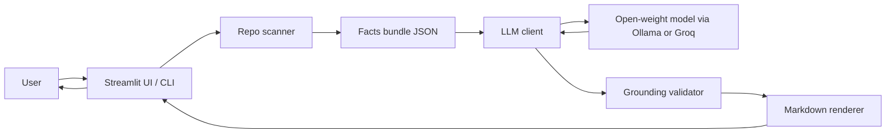
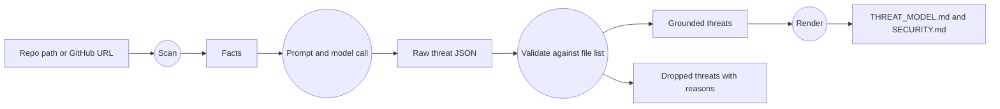

# 🛡️ ThreatSketch

> **Status: MVP (minimum viable product).** ThreatSketch works end to end, but it is an early version built for a hackathon. Its output is a starting point for human review, not a security audit. See [Known limitations](#known-limitations) and [Roadmap](#roadmap).

Point it at a repository and get a **STRIDE threat model** and a **SECURITY.md**. A small open-weight model writes them, and code checks the result so that every threat cites a file that really exists.

Built for **Hacktoberfest Islamabad 2026**, Developer & Open Source domain.

---

## Table of contents

- [Problem, user and solution](#problem-user-and-solution)
- [What is in the MVP](#what-is-in-the-mvp)
- [How it works](#how-it-works)
- [AI component](#ai-component)
- [Architecture](#architecture)
- [Project structure](#project-structure)
- [Setup](#setup)
- [Usage](#usage)
- [Configuration](#configuration)
- [What the scanner detects](#what-the-scanner-detects)
- [Output files](#output-files)
- [Testing and findings](#testing-and-findings)
- [Security and privacy](#security-and-privacy)
- [Troubleshooting](#troubleshooting)
- [Known limitations](#known-limitations)
- [Roadmap](#roadmap)
- [Team](#team)
- [License](#license)
- [Acknowledgements](#acknowledgements)

---

## Problem, user and solution

**Problem.** Small teams, student projects and open-source maintainers often have no threat model and no SECURITY.md. Writing either from scratch is slow, and generic templates ignore what the project actually does.

**Who it is for.**
- Open-source maintainers who need a SECURITY.md before a public release
- Student teams and hackathon projects
- Startups that don't have a security engineer
- Anyone who wants a quick first pass at "what could go wrong here?"

**Solution.** ThreatSketch:
1. Scans a repo for hard facts: the file tree, dependencies, entry points, routes, environment-variable names and auth-related files.
2. Asks a small model for a structured STRIDE threat model based only on those facts.
3. Drops every threat that cites a file that is not in the repo.
4. Renders two files: `THREAT_MODEL.md` and `SECURITY.md`.

The design rule is that **scanners collect facts and the model only reasons over them**. The model never sees source code. The tool reports how many threats the model proposed, how many were kept and how many were dropped, with the reason for each drop.

---

## What is in the MVP

| Feature | Status |
| --- | --- |
| Scan a local folder | ✅ |
| Scan a public GitHub repo by URL (shallow clone) | ✅ |
| Python and JavaScript/TypeScript fact extraction | ✅ |
| STRIDE threat model from a local model (Ollama) | ✅ |
| Hosted model fallback (Groq), switched by environment variables | ✅ |
| Grounding validator that drops threats citing missing files | ✅ |
| `THREAT_MODEL.md` and `SECURITY.md` generation | ✅ |
| Web UI with light and dark mode | ✅ |
| Threat cards with a severity filter, STRIDE coverage chips and a dropped-threats report | ✅ |
| Download as `.md` files, a `.zip` bundle or `threats.json` | ✅ |
| Live model connection status in the sidebar | ✅ |
| Command-line interface | ✅ |
| Automated tests for the deterministic code | ✅ (10 tests) |
| Other languages (Go, Java, PHP, Ruby, Rust, C#) | ❌ Not yet. See [Roadmap](#roadmap) |
| Private repositories, GitLab or Bitbucket | ❌ Not yet |
| Finding concrete vulnerabilities (SAST) | ❌ Out of scope |

---

## How it works

1. **Scan (no AI).** [`scanner.py`](scanner.py) walks the repo, skipping `.git`, `node_modules`, virtual environments and build folders. It records:
   - the file list
   - dependencies
   - entry points
   - HTTP routes
   - environment-variable names
   - auth-related files
   - files that probably hold secrets (by name only; it never reads them)
   - keyword hints such as "runs SQL queries" or "uses eval"

   The result is a **facts bundle**, capped at about 12,000 characters so that a small model keeps its instructions.
2. **Reason (AI).** [`threatmodel.py`](threatmodel.py) sends the facts bundle and a strict system prompt to the model. The model must return JSON containing 6–10 threats, covering at least four STRIDE categories. Each threat cites exactly one file as evidence.
3. **Parse.** The tool extracts the JSON, even when it is wrapped in `<think>` tags or code fences. If parsing fails, it tells the model what was wrong and retries, up to 3 attempts in total.
4. **Validate (grounding check).** Each threat is checked:
   - Is the category a real STRIDE category?
   - Does the cited file exist in the scanned list?
   - Are the description and mitigation present?
   - Is it a duplicate?
   - Is it over the limit of 15 threats?

   Anything that fails is **dropped, with a reason**. Path tricks such as `./`, `../`, line numbers or backslashes are normalized before the file lookup.
5. **Render.** The kept threats are sorted by severity and rendered into `THREAT_MODEL.md`. `SECURITY.md` is a fixed policy template; only its *scope* and *higher-risk areas* sections come from the validated threats.

---

## AI component

<!-- Edit this section to match exactly what you ran. Verify the model name and size before submitting. -->

- **Model:** Qwen3-4B (about 4B parameters, Apache-2.0), Ollama tag `qwen3:4b`
- **Runtime:** local, through Ollama's OpenAI-compatible endpoint at `http://localhost:11434/v1`
- **Fallback:** Llama 3.1 8B Instant (8B parameters) through Groq
- **What the model does:** all threat identification, mitigation drafting, severity rating and the repo summary. Without it, the tool only lists files.
- **What code does:** scanning, prompt size limits, JSON parsing with retries, the grounding check and both Markdown renderers.
- **Integration:** the `openai` Python client, configured by the `BASE_URL`, `API_KEY` and `MODEL` environment variables. Switching between Ollama and Groq needs no code change.
- **Qwen3 handling:** the tool appends `/no_think` to the prompt for Qwen3 models and strips any `<think>…</think>` blocks before parsing.

---

## Architecture



### Data flow



---

## Project structure

```
ThreatSketch/
├── app.py                  # Streamlit web UI
├── threatmodel.py          # Prompt, model call, JSON parsing, grounding validator, renderers, CLI
├── scanner.py              # Repo scanner, builds the facts bundle (no AI)
├── requirements.txt        # Runtime dependencies (openai, streamlit)
├── requirements-dev.txt    # Adds pytest
├── .env.example            # Template for model settings
├── .streamlit/
│   └── config.toml         # Light and dark themes
├── examples/
│   ├── sample_flask_app/   # Small Flask fixture app
│   └── sample_express_app/ # Small Express fixture app
├── tests/
│   └── test_threatsketch.py
└── LICENSE                 # MIT
```

| File | Role |
| --- | --- |
| `scanner.py` | Walks the repo and builds the facts bundle. No AI. |
| `threatmodel.py` | Prompt, model call, JSON parsing, grounding validator, renderers, CLI. |
| `app.py` | Streamlit UI. |
| `tests/` | pytest suite for the deterministic parts. |
| `examples/` | Two small fixture apps to test against. |

---

## Setup

**Requirements:**
- Python 3.10 or newer
- Git, for scanning by GitHub URL
- [Ollama](https://ollama.com) for the local model, *or* a Groq API key

### 1. Get the code and install dependencies

```bash
git clone https://github.com/<your-username>/ThreatSketch.git
cd ThreatSketch
python -m venv .venv
```

Activate the virtual environment:

```bash
# macOS / Linux
source .venv/bin/activate
# Windows (PowerShell)
.venv\Scripts\Activate.ps1
```

Then install:

```bash
pip install -r requirements.txt
```

### 2a. Option A: local model with Ollama (default)

Install Ollama, then pull the model (about 2.5 GB):

```bash
ollama pull qwen3:4b
```

No `.env` file is needed. ThreatSketch defaults to `http://localhost:11434/v1` and `qwen3:4b`.

### 2b. Option B: Groq (fast, hosted)

Copy `.env.example` to `.env` and set:

```
BASE_URL=https://api.groq.com/openai/v1
API_KEY=<your Groq key>
MODEL=llama-3.1-8b-instant
```

`.env` is listed in `.gitignore`. Never commit it.

---

## Usage

### Web UI

```bash
streamlit run app.py
```

Open http://localhost:8501, then:

1. Click **🐍 Flask example** or **🟨 Express example**, or type a local folder path or a public GitHub URL.
2. Click **Generate ⚡**. A status panel shows each step: cloning, scanning (with file, route and dependency counts), asking the model, and validating.
3. Review the results:
   - **Stat cards:** threats proposed, kept and dropped, and STRIDE coverage
   - **STRIDE chips:** which of the six categories are covered
   - **🎯 Threats:** severity-colored cards, with a filter by severity
   - **📄 THREAT_MODEL.md** and **🔐 SECURITY.md:** rendered previews
   - **🗑️ Dropped:** each rejected threat and why
   - **🔍 Facts sent to model:** exactly what the model saw
4. Download the files on their own or as one `.zip` (which also contains `threats.json`).

**Light and dark mode:** the UI follows your system theme. To switch manually, open the **⋮** menu in the top right, then **Settings → Theme**. The sidebar shows whether the model endpoint is reachable (🟢 or 🔴).

### Command line

```bash
python threatmodel.py <repo-path> <output-dir>
# example
python threatmodel.py examples/sample_flask_app output/
```

It prints a one-line summary, for example `Model proposed 8 threats, kept 7, dropped 1; 5 STRIDE categories; 1 model attempt(s).` It then writes `THREAT_MODEL.md` and `SECURITY.md` to the output folder.

> **Speed:** on a CPU-only machine, `qwen3:4b` can take several minutes per repo. The client timeout is 600 seconds. If that is too slow, use Groq or a smaller model such as `qwen3:1.7b`.

---

## Configuration

| Variable | Default | Purpose |
| --- | --- | --- |
| `BASE_URL` | `http://localhost:11434/v1` | Any OpenAI-compatible endpoint |
| `API_KEY` | `ollama` | API key; Ollama ignores it |
| `MODEL` | `qwen3:4b` | Model name or tag |

Values are read from the environment or from a `.env` file in the project root. Existing environment variables take precedence over `.env`.

Limits are set as constants in the code:

| Constant | Value | Where |
| --- | --- | --- |
| Max files scanned | 300 | `scanner.py` (`MAX_FILES`) |
| Max bytes read per file | 200 KB | `scanner.py` (`MAX_READ_BYTES`) |
| Max facts bundle size | 12,000 chars | `scanner.py` (`MAX_PROMPT_CHARS`) |
| Max threats kept | 15 | `threatmodel.py` (`MAX_THREATS`) |
| Model retries | 2 (3 attempts total) | `threatmodel.py` (`call_model`) |
| Model timeout | 600 s | `threatmodel.py` (`get_client`) |
| Clone timeout | 120 s | `app.py` (`clone`) |

---

## What the scanner detects

| Fact | How |
| --- | --- |
| **Code files** | `.py`, `.js`, `.jsx`, `.ts`, `.tsx`, `.mjs`, `.cjs` |
| **Dependencies** | `requirements*.txt`, `package.json` (including devDependencies), `pyproject.toml` (PEP 621 and Poetry) |
| **Entry points** | `main.py`, `app.py`, `manage.py`, `wsgi.py`, `asgi.py`, `server.py`, `run.py`, `index/app/main/server.js/ts`, `Dockerfile`, `docker-compose.yml`, `Procfile` |
| **Routes** | Flask/FastAPI decorators (`@app.get`, `@app.route(..., methods=[...])`), Django `urls.py` `path()`, Express-style `app/router.get(...)` |
| **Env var names** | `os.environ[...]`, `os.getenv(...)`, `process.env.X`, `import.meta.env.X` (names only, never values) |
| **Auth-related files** | Paths containing auth, login, session, jwt, oauth, password, token, permission, middleware, crypto and similar words |
| **Secret-like files** | `.env*`, `*.pem`, `*.key`, `id_rsa`, `credentials`, `secrets.json/yaml/toml`. Their existence is recorded; their **contents are never read** |
| **Keyword hints** | subprocess and shell calls, eval/exec, pickle or unsafe YAML, SQL, database libraries, file uploads, file paths built from requests, debug mode, CORS, password hashing, JWT, cookies and sessions, outbound HTTP, HTML templating |

Keyword hints mean "this API appears in this file", **not** "this file is vulnerable".

---

## Output files

**`THREAT_MODEL.md`** contains:
- a disclaimer
- a grounding report (proposed, kept and dropped counts, STRIDE coverage, files scanned)
- the model's summary
- a list of components
- a threats table (category, component, evidence file, threat, mitigation, severity)
- the dropped threats with reasons
- the scanner facts used

**`SECURITY.md`** contains:
- supported versions
- how to report a vulnerability, with a placeholder contact `REPLACE-ME@example.com`
- response targets
- scope (in and out)
- higher-risk areas from the threat model
- a safe-harbour statement
- a disclosure policy

**Before publishing SECURITY.md, the maintainer must:**
- replace the placeholder contact with a real private address
- adjust the response times to targets they can actually meet

**`threats.json`** (zip download only) contains the raw kept and dropped threats, for tooling.

---

## Testing and findings

### Automated tests

```bash
pip install -r requirements-dev.txt
pytest
```

There are 10 tests. They cover:
- scanning the Flask and Express fixtures
- skipping vendored folders and never reading secret files
- truncation and prompt size limits
- JSON extraction through `<think>` tags and code fences
- dropping ungrounded threats
- rejecting path tricks
- end-to-end generation with a retry
- clear error messages
- escaping model text in the Markdown output

The tests use a fake model client, so they check the deterministic code only and say nothing about model quality. **Last run: 10 passed.**

### Runs against a real model

<!-- Fill this in from your own runs. Report what actually happened. -->

| Scenario | Input | Expected | Actual | Pass or fail | Issues |
| --- | --- | --- | --- | --- | --- |
| Flask app | `examples/sample_flask_app` | At least 4 STRIDE categories, all cited files exist | _to fill in_ | | |
| Express app | `examples/sample_express_app` | Route and dependency risks identified | _to fill in_ | | |
| Own project | _your repo_ | Relevant threats, valid SECURITY.md | _to fill in_ | | |
| Empty folder | A new empty folder | Clear message, no crash | _to fill in_ | | |
| Invalid model output | Model that returns no JSON | Retry, then a clear error | _to fill in_ | | |

For each real run, record the number of threats proposed, kept and dropped, and review five kept threats by hand for relevance.

---

## Security and privacy

- **Source code is never sent to the model.** Only the facts bundle is sent. You can see it in the UI's **Facts sent to model** tab.
- **Secrets are never read.** Files that look like secrets are recorded by name only, and environment variables are recorded by name, never by value.
- **The local model keeps everything on your machine.** With Ollama, nothing leaves your computer. With Groq, the facts bundle (file names, routes, dependency names) is sent to Groq.
- **Model text is escaped** before it is rendered as Markdown or HTML, so a model reply cannot inject markup into the page.
- **Cloning is restricted** to `https://github.com/owner/repo` URLs. It uses a shallow clone (`--depth 1`) and `--` to stop the URL from being read as a git option, and times out after 120 seconds.

---

## Troubleshooting

| Problem | Fix |
| --- | --- |
| Sidebar shows 🔴 **Endpoint not reachable** | Start Ollama (open the app or run `ollama serve`), or check `BASE_URL` |
| Sidebar shows 🔴 **Model not found** | Run `ollama pull qwen3:4b`, or set `MODEL` to a model you already have (`ollama list`) |
| `Request timed out` | The model is slow on CPU. Use Groq, a smaller model, or raise `timeout` in `get_client` |
| `The model did not return valid JSON after 3 attempts` | Try again, or switch to a larger or different model |
| Very few threats kept | The model cited files that don't exist. Check the **Dropped** tab, then retry or try another model |
| `That folder does not exist` | Use a path relative to where you started Streamlit, or an absolute path |
| `Could not clone that repository` | The repo must be public and on github.com, and Git must be installed |
| Emojis or unicode errors on the Windows CLI | Set `PYTHONIOENCODING=utf-8` |

---

## Known limitations

This is an MVP. In particular:

- **Grounding proves that a cited file exists.** It does not prove the threat is real or that the list is complete. The output is a starting point for human review.
- **A small model can miss threats** that depend on runtime behaviour, deployment setup or business logic that static facts do not reveal.
- **The scanner is heuristic** and covers mainly Python and JavaScript/TypeScript. Other stacks only contribute their file tree and file names, so their results are much more generic.
- **It does not run the code** and does not find specific vulnerabilities such as injection flaws.
- **Prompt injection risk:** file paths, route strings and dependency names from the scanned repo are passed to the model, and a hostile repo could use them to try to steer it. The validator still checks every citation, but the wording of kept threats is not verified.
- **SECURITY.md needs editing:** the contact is a placeholder, and the response times are defaults to adjust.
- **Size limits:** large repositories are truncated at 300 files, and the facts bundle is capped at about 12,000 characters.
- **Public GitHub only:** cloning by URL works for public GitHub repositories only.
- **Speed:** local inference on CPU can take several minutes.

---

## Roadmap

Possible next steps after the MVP:

- [ ] Scanner support for Go (`go.mod`), Java (`pom.xml`, Gradle), PHP (`composer.json`), Ruby (`Gemfile`), Rust (`Cargo.toml`) and C# (`.csproj`)
- [ ] Analysis of infrastructure files: Dockerfile, Kubernetes manifests, Terraform, GitHub Actions workflows
- [ ] Known-vulnerability lookup for dependencies (for example the OSV database)
- [ ] Line-level evidence: checking that a cited route or pattern really appears in the cited file
- [ ] Private repositories, GitLab and Bitbucket
- [ ] A GitHub Action that opens a PR with `THREAT_MODEL.md` and `SECURITY.md`
- [ ] Diffing threat models between commits
- [ ] Data flow diagram (DFD) generation
- [ ] Export to SARIF or the OWASP Threat Dragon format

---

## Team

<!-- List every team member and what they did. -->

- _Name_ — _contribution_

**AI-assisted development.** Claude (Anthropic) was used as a coding assistant while building this project. <!-- Describe which parts, and what the team wrote, reviewed and tested. -->

---

## License

MIT. See [LICENSE](LICENSE).

## Acknowledgements

<!-- Keep only the ones you actually used, and check each license yourself. -->

- Qwen3 by the Qwen team (Apache-2.0)
- [Ollama](https://ollama.com)
- Groq and Llama 3.1 by Meta (Llama 3.1 Community License), if the fallback is used
- [openai-python](https://github.com/openai/openai-python) client library
- [Streamlit](https://streamlit.io)
- The STRIDE methodology, which originated at Microsoft
